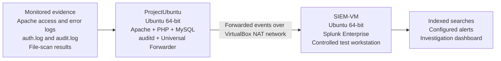
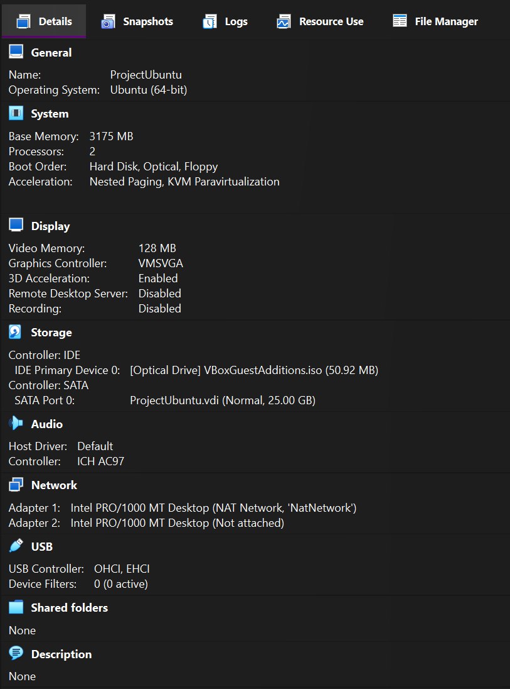
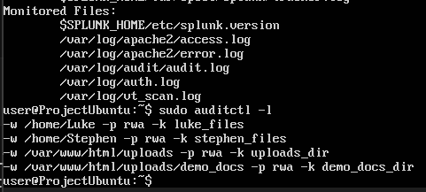
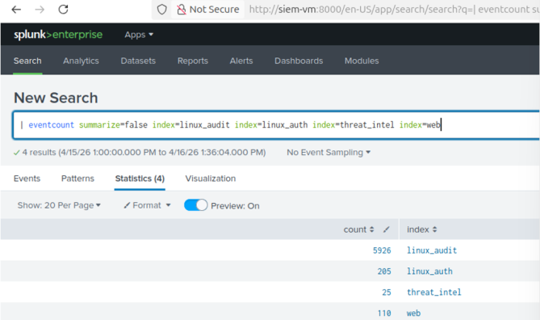

# Splunk SIEM Attack Detection Lab

**Security monitoring | Attack investigation | Splunk Enterprise | Ubuntu | 2026**  
**University of Limerick — Group project**  
**Contributors:** Stephen Mc Neill Killeen and Luke O'Sullivan

A documentation-based showcase of a controlled, two-VM cybersecurity lab. We configured **Splunk Enterprise** to ingest and investigate events from an intentionally vulnerable **Ubuntu / Apache / PHP / MySQL** server, then used those events to study a simulated intrusion from initial web access through privileged file manipulation.

> **Lab-only demonstration:** All target services, accounts and sensitive-looking files were created for an authorised university exercise using demonstration data. This repository is not a public attack target, a production SIEM deployment or a runnable copy of the two virtual machines.

## At a glance

- Built a **two-Ubuntu-VM environment** in Oracle VirtualBox using a NAT network.
- Collected web access/error, system authentication and `auditd` events through **Splunk Universal Forwarder** into Splunk Enterprise.
- Established a baseline, then observed a **simulated SQL-injection-to-privilege-escalation attack sequence** in monitored logs.
- Configured searches and named Splunk alerts for reconnaissance, web-shell activity, file access and related behaviour.
- Added **VirusTotal file-hash checking** through a custom Python integration described in the report.
- Compared the advantages of Splunk's searchable/indexed events with issues encountered during an earlier Wazuh attempt.

For the problem statement, objectives and success criteria written for this portfolio, see **[Project overview](PROJECT-OVERVIEW.md)**.

## Lab architecture



The **SIEM-VM** doubled as the authorised test workstation. **ProjectUbuntu** hosted the vulnerable web application. Both machines were connected through VirtualBox's `NatNetwork`.

| Setting | SIEM-VM | ProjectUbuntu (web server) |
|---|---|---|
| Guest OS | Ubuntu 64-bit | Ubuntu 64-bit |
| Allocated virtual CPUs | 5 | 2 |
| Allocated RAM | 10,048 MB | 3,175 MB |
| Virtual disk | 80.61 GB | 25.00 GB |
| Primary network adapter | NAT Network | NAT Network |




See [Lab architecture and monitoring setup](docs/lab-architecture.md) for more detail.

## Security log collection

Splunk Universal Forwarder on the web-server VM sent events to Splunk Enterprise on the SIEM VM, where the logs were indexed and searched.

| Source | Evidence used for investigation |
|---|---|
| Apache access and error logs | Suspicious HTTP requests, SQL injection indicators, web-shell request patterns |
| Ubuntu authentication logs | Authentication and privilege-related system activity |
| `auditd` | File reads, changes and attempts involving protected directories and web uploads |
| Custom VirusTotal scan log | File-hash lookups and returned threat-intelligence results |

The project monitored both the web upload directory and demonstration user-home folders through `auditd` watches. The following evidence images are extracted from our presentation and report.





## Simulated intrusion and investigation

We used a deliberately vulnerable PHP login and controlled attack activity to generate events for monitoring:

1. **Baseline:** verified that expected server and system logs were arriving in Splunk before the attack.
2. **Initial access:** demonstrated an authentication bypass through SQL injection in the lab application.
3. **Web-shell activity:** recorded HTTP requests associated with command execution in the vulnerable environment.
4. **Reconnaissance:** examined file paths, users and directories, including failed access to protected demonstration files.
5. **Privilege escalation:** identified and used a lab-created SUID misconfiguration, moving from the web-server account to elevated privileges.
6. **File access and modification:** checked previously restricted files and verified a protected-file change.
7. **Detection and review:** analysed Apache and system events in Splunk to reconstruct the key stages.

**Important:** The project report's title references CVE-2018-7422. The materials document a deliberately vulnerable lab login and server; they do not provide an independently validated reproduction of a vendor-specific CVE exploit.

## Splunk configured alerts

The presentation documents these alert definitions in Splunk Enterprise:

| Named alert | Intended monitoring purpose |
|---|---|
| `SQL Injection Attempt` | Detect suspicious application requests |
| `Web shell activity` | Identify web-shell request patterns |
| `Recon Activity` | Highlight directory or command reconnaissance |
| `Standard Directory File Activity` | Monitor activity in standard watched locations |
| `Privileged Directory File Activity` | Flag events in sensitive demonstration folders |
| `Auditd file access detected` | Surface watched file-access events |
| `Privileged web shell activity` | Monitor web-shell activity with elevated privileges |
| `Malicious file detected by virus total` | Alert on file scan results indicating a malicious finding |


**Detection nuance:** The team observed evidence of multiple attack stages. The VirusTotal-based malicious-file alert was configured, **but the demonstration PHP web shell was not flagged as malicious by VirusTotal**. Having an alert configured does not imply that it fired during the test.

Read the [detection evidence and limitations](docs/detection-evidence.md) for details.

## Findings and lessons learned

- **Combining log sources increased visibility.** Apache logs explained web-facing activity while `auditd` provided evidence of changes and attempted access at the filesystem level.
- **Baseline comparison helped separate expected activity from suspicious events** generated during the controlled intrusion.
- **Searchable, indexed SIEM data improved investigation**, enabling the team to review related events and build targeted alert definitions.
- **Access control and secure development both matter.** A web application flaw combined with a deliberately unsafe SUID configuration enabled a deeper compromise.
- **Tooling requires evaluation.** Earlier Wazuh testing produced noisy outputs and rule-matching difficulties; Splunk was selected for the completed demonstration.

## Technologies

**Splunk Enterprise · Splunk Universal Forwarder · SPL (search and alerting) · Ubuntu Linux · VirtualBox · Apache HTTP Server · PHP · MySQL · auditd · VirusTotal API · Python**

## Repository contents

```text
splunk-siem-attack-detection-lab/
├── README.md
├── PROJECT-OVERVIEW.md
├── .gitignore
└── docs/
    ├── project-report.pdf
    ├── presentation.pdf
    ├── lab-architecture.md
    ├── detection-evidence.md
    └── images/
        ├── siem-vm-settings.png
        ├── webserver-vm-settings.png
        ├── splunk-configured-alerts.png
        ├── splunk-indexed-logs.png
        └── auditd-and-monitored-logs.png
```

## Project documentation

- **[Project report — PDF](docs/project-report.pdf)**: lab environment, simulated intrusion, event analysis, findings and references.
- **[Presentation — PDF](docs/presentation.pdf)**: six slides including the vulnerability, attack evidence, log collection and configured Splunk alerts.
- **[Project overview and objectives](PROJECT-OVERVIEW.md)**: independently written portfolio summary of the project's purpose and outcomes.
- **[Lab architecture](docs/lab-architecture.md)** and **[Detection evidence](docs/detection-evidence.md)**: readable technical summaries.

## Reproducibility and limitations

This is a **technical case study rather than an executable project**. The archived VM disks, vulnerable application source, saved SPL queries, full Splunk configuration, VirusTotal script and raw log exports are not part of the available portfolio materials. Their absence is intentional; no missing queries, code or config have been fabricated for this repository.

All demonstrations were conducted using deliberately vulnerable services within a controlled university lab. The two VM screenshots and supporting documents capture the environment and evidence available at the time. **Do not deploy the vulnerable example as a public service.**

## Credits

Created collaboratively by **Stephen Mc Neill Killeen** and **Luke O'Sullivan** at the University of Limerick (2026). Both contributors are credited; the material here does not claim that either individual independently completed every implementation task.

*Splunk, VirtualBox and other product names belong to their respective owners. This is an independent academic portfolio project.*
