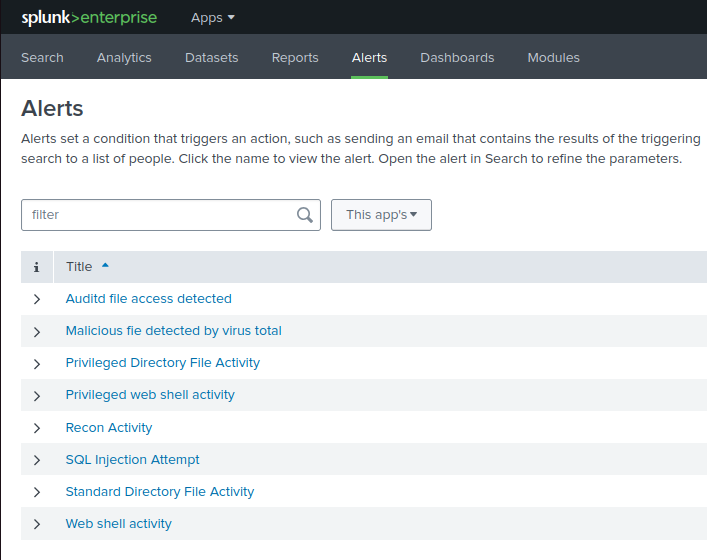

# Detection Evidence and Limitations

## What the team investigated

The report documents a baseline followed by an authorised, multi-stage intrusion against a deliberately vulnerable Apache/PHP/MySQL lab application. Suspicious HTTP requests, web-shell commands, reconnaissance, access attempts, successful file creation, SUID-assisted privilege escalation and protected-file modification were examined using logs collected into Splunk Enterprise.

## Documented configured alerts

The following names are visible in the presentation's Splunk alert list. They represent **configured alert definitions**, not proof that every rule triggered during the demonstration.

| Splunk alert name | Intended use |
|---|---|
| `SQL Injection Attempt` | Watch for suspicious web requests associated with the SQL injection exercise |
| `Web shell activity` | Surface requests carrying command-execution patterns |
| `Recon Activity` | Review host/directory exploration patterns |
| `Standard Directory File Activity` | Observe activity in ordinary watched folders |
| `Privileged Directory File Activity` | Track activity involving privileged/restricted demonstration locations |
| `Auditd file access detected` | Identify access events from `auditd` |
| `Privileged web shell activity` | Flag elevated web-shell activity |
| `Malicious file detected by virus total` | Surface malicious reputation outcomes if returned by a file scan |

## Evidence by stage

1. **Application entry:** Apache access and error logs were used to identify suspicious login and HTTP requests.
2. **Web-shell requests:** Repeated `cmd=` parameters in web requests were reviewed as indicators of command execution through the lab application's file-upload weakness.
3. **Reconnaissance:** Commands associated with directory listing and system exploration were visible in recorded activity.
4. **File-access monitoring:** `auditd` allowed observation of selected file-access and modification attempts in watched directories.
5. **Privilege escalation and access:** The test demonstrated elevated execution via a purposely misconfigured SUID binary and subsequent access to previously restricted example files.
6. **Post-compromise monitoring:** Splunk views collected the evidence used to describe the simulated attack progression in the report.

## What was and was not detected

The team reported alerting and log visibility corresponding to multiple stages of the attack. However, the uploaded PHP web shell **was not classified as malicious by VirusTotal** during the documented run. This distinction matters: the VirusTotal alert was configured, but a positive malicious-file reputation verdict was not demonstrated.

The presented screenshots and narrative do not supply all of the underlying SPL definitions, the original raw event export or repeatable test metrics. Accordingly, this repository does **not** claim full detection coverage, zero false positives or a production-quality alerting system.

## Referenced documentation

- [Full project report](project-report.pdf)
- [Presentation slides](presentation.pdf)
- [Main README](../README.md)

*All activity took place in an authorised educational lab using demonstration data.*
