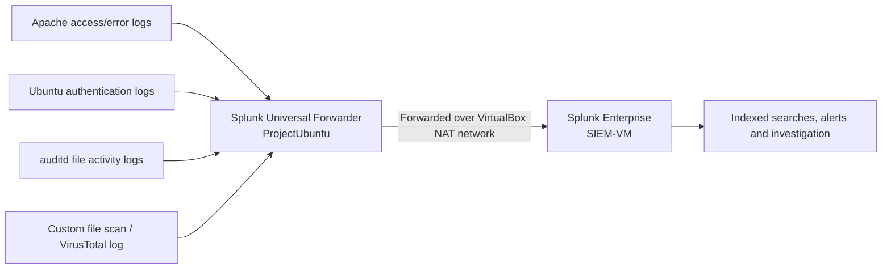

# Lab Architecture and Monitoring Setup

## VirtualBox setup

The environment consisted of two **Ubuntu 64-bit** machines connected to a VirtualBox NAT network named `NatNetwork`. The SIEM instance also served as the controlled test workstation. A second machine hosted the vulnerable PHP web application and the log-forwarding agent.

| Virtual machine | Role | CPU allocation | RAM allocation | Virtual disk |
|---|---|---:|---:|---:|
| `SIEM-VM` | Splunk Enterprise, investigation interface, controlled attacker workstation | 5 virtual CPUs | 10,048 MB | 80.61 GB |
| `ProjectUbuntu` | Apache/PHP/MySQL application, authentication and file auditing, Splunk Universal Forwarder | 2 virtual CPUs | 3,175 MB | 25.00 GB |

The settings above come from the original VirtualBox screenshots; they are allocated VM resources, **not measured runtime utilisation**.

## Data flow

## Monitored sources

- Apache access and error logs: evidence of suspicious requests and web-shell activity.
- Ubuntu authentication logs: authentication and privilege-related events.
- `auditd`: monitored file access/creation/modification within selected web and user-home locations.
- Custom file-scan results: hash checks and VirusTotal reputation outcomes processed via a Python integration and logged for Splunk ingestion.

## Baseline and evidence capture

The team confirmed log forwarding and indexing before executing the simulated intrusion. This provided a reference period for comparing later web requests, filesystem changes and unusual privilege-related activity. The resulting evidence and screenshots are described in the [report](project-report.pdf).

## Boundaries

The archived virtual disks, exact saved Splunk configuration files, networking exports and complete code are **not** available in the supplied project record. This document reconstructs the setup at an architectural level, without presenting guessed values as exact deployment settings. The service was a purposely vulnerable educational system, not a production installation.
